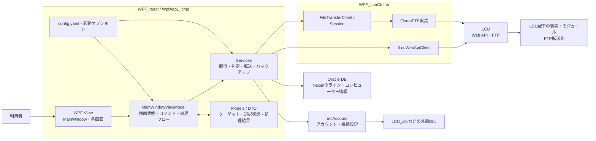
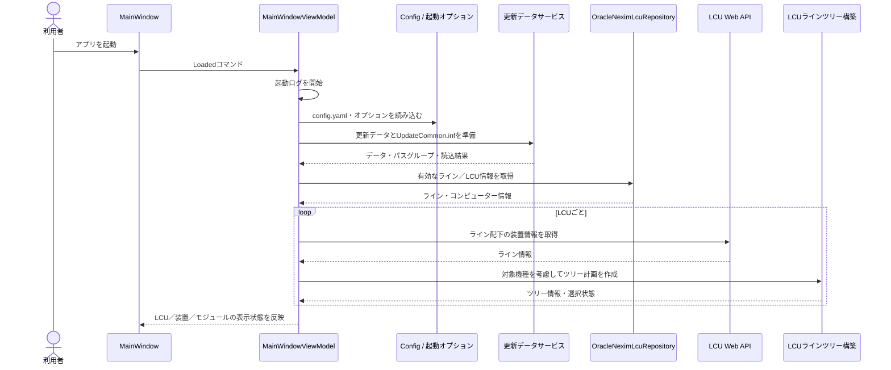
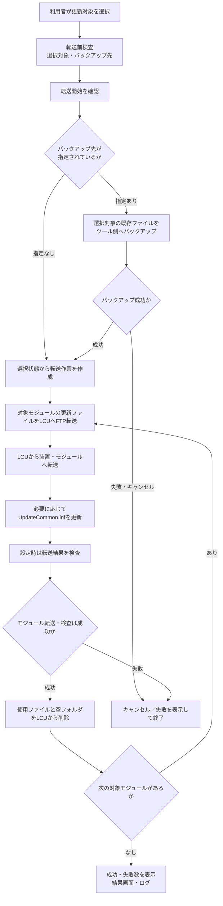

# 更新ツールのアプリケーション全体像

## 目的

WPFの画面から更新対象を選択し、更新データとターゲット側の `UpdateCommon.inf` をもとに、LCUおよび配下の装置・モジュールへファイルを配布するアプリケーションです。更新前に既存ファイルをツール側へバックアップし、転送結果や検査結果を画面・ログに記録します。

現在の転送実装はFTPです。SFTP／SSHは将来の拡張候補であり、この文書に記載する現行実装には含まれません。

## システム構成

### 主な構成要素

| 要素 | 主な責務 |
|---|---|
| `WpfApp1_cmd` | WPF画面、ViewModel、アプリケーションの処理フロー |
| `MainWindowViewModel` | コマンド受付、画面状態・選択状態の反映、ダイアログ／進捗表示、サービス呼出しの調整 |
| `Services` | データ取得、入力・選択の処理、バックアップ、転送、検査、結果・診断文の生成 |
| `Models` | LCU／装置／モジュール／ユニットなどの画面・業務データ |
| `WpfLcuCtrlLib` | ファイル転送とLCU Web APIの抽象化。現在のファイル転送実装はFluentFTP |
| `OracleNeximLcuRepository` | Oracleから有効なラインとLCUコンピューター情報を取得 |
| `mcAccount`・外部DLL | アカウント情報や既存のLCU連携機能を提供 |

### LCUの接続確認・更新準備サービス

LCU関連の処理は、実行と結果表示・診断文の生成を役割ごとにまとめています。

| サービス | 主な責務 |
|---|---|
| `LcuNetworkCheckService` | Pingとバージョンによる接続確認、接続確認ダイアログの生成 |
| `LcuInformationService` | FTPアカウント・バージョン・Dドライブ空き容量の取得、容量確認ダイアログの生成 |
| `LcuUpdatePreparationService` | 更新前の接続・情報・必要容量の確認、画面反映アクションと診断文の生成 |

Pingの再試行・キャンセルは`LcuReachabilityService`、LCU API呼出しは`LcuCtrlInformationGateway`に分離しています。取得順序、FTPアカウント設定済みの場合の省略、エラー表示と容量不足時の継続可否は統合前と同じです。

### LCUのライン情報・ツリー構築サービス

| サービス | 主な責務 |
|---|---|
| `LcuLineInfoService` | ライン情報の取得・XML応答解析、LCUの順次読込、進捗・結果・診断文の生成 |
| `LcuLineTreeService` | 対応機種に応じたツリー計画、選択数と三状態選択の集計、読込完了時の状態決定 |
| `LcuLineTreeItemBuilder` | 計画をWPFの装置・ベース・モジュールへ反映し、親子関係とIPアドレスを設定 |

通信窓口は`LcuCtrlLineInfoGateway`に残し、画面依存の項目構築と画面に依存しない判定を分離しています。HTTP例外時に次のLCUへ継続する動作、キャンセル時の中断、非対応機種の扱いと選択状態は維持しています。

## メイン画面のサイズ調整

メインウィンドウはサイズ変更に対応しています。左のツリーと右の表示領域の境界、および右の一覧（VersionListなど）とExecution Logの境界は、分割バーのドラッグで調整できます。各領域は変更後の比率に応じてウィンドウのサイズ変更に追従します。一覧とログは領域内でスクロールし、転送・終了ボタンは下端の独立した領域に表示します。

Execution Logの縦スクロールバーは、ログの行数や領域の高さにかかわらず常時表示します。
ログ領域の右クリックメニューにはコピー・すべて選択・クリアを用意しています。クリアは画面のログのみを消去し、ログファイルは削除しません。以後のログは引き続き表示されます。
ログ用の`BindableRichTextBox`には、`RichTextBox`の暗黙スタイルを明示的に指定しています。派生コントロールにこの指定がないと、テーマ適用時にログの内容量がスクロール範囲に反映されないためです。

### カラーテーマ

「設定 → カラーテーマ」でライト／ダーク／システムを選択できます。初期値はシステムです。システム選択時はWindowsの「既定のアプリモード」に追従し、起動中の設定変更も反映します。選択はユーザーごとの`%LOCALAPPDATA%\Fuji\UnitSoftTransferTool\theme.txt`に保存します。読み込み・保存に失敗した場合はエラーを表示します。

テーマ変更はMahAppsとMaterial Designの両方に適用し、既存ログの文字・背景・エラー／警告／成功の配色も即時更新します。ログのスクロール位置や内容はテーマ変更では初期化しません。

Material Designのパレット定義は`App.xaml`の`MahAppsBundledTheme`に一本化しています。`BundledTheme`を重ねて登録すると、変更されていない側のリソースが優先され、ツリー・一覧・メニューの背景色や文字色が選択したテーマと一致しなくなるため、追加しないでください。

ツールチップは共通スタイルでテーマの背景色と文字色を組にして指定し、通常の説明とツリーの詳細表示で配色を統一しています。

各一覧ではマウスを乗せた行を青系の背景で強調し、選択行はより強い背景色と左端のラインで区別します。選択表示はマウスを重ねても、フォーカスが外れても維持します。配色はライト／ダークに合わせ、状態を示す文字色やチェックボックスの選択動作は変更しません。

交互行の背景は共通の行スタイルの`AlternationIndex`で設定し、選択・マウス強調・交互色の順に優先します。各一覧で`AlternatingRowBackground`を指定すると交互行の強調表示を上書きするため、個別には指定しません。通常行と交互行の背景コントラストは両テーマで1.3:1以上を確保しています。

## 起動からライン表示まで

更新データの準備では、指定フォルダーやアーカイブを確認し、`UpdateCommon.inf` を読み込みます。アーカイブが存在する場合は容量を確認して展開し、設定されたユニット連携情報とともにパスグループを構成します。
起動時の更新情報一覧には、ディレクトリを除く `UpdateCommon.inf` のファイル定義を、実ファイルが未配置の場合も含めて表示します。転送用のパスグループには、実在するファイルだけが含まれます。

ユニット一覧作成時、更新データ側にのみ存在し装置側の定義に無い項目は `[INFO] ...=skip (not in machine UpdateCommon.inf; not required)`、同一バージョンによる除外は `[INFO] ...=sameVersion` と記録します。転送後のINF検証では、検証対象一覧に無いセクションを `[INFO] ...=skip (not in inspection targets)` とし、装置側に無い項目とは区別します。一致したバージョンは `[INFO] ...=sameVersion`、実際のバージョン不一致や取得失敗は従来どおりエラーとして記録します。

転送後のINF検証に使用する期待値は、画面の現在バージョンとは別に保持します。グループ転送に成功し、INFのバージョン更新対象になった項目だけ更新後バージョンへ切り替えます。未選択・転送失敗・パス不一致の項目は元のバージョンで検証します。

各モジュールの転送直前に、必要なファイルのみFTPの `/MCFiles` 配下へアップロードします。LCU単位の事前一括アップロードは行いません。モジュールの転送・INF配置と、有効な場合の検査が成功した後、過去の残存分も含め `/MCFiles` 配下の全ファイル・フォルダを削除します。後続モジュールで必要な共有ファイルは転送直前に再アップロードします。`/MCFiles` 自体と、その外側のファイルは残します。削除後に一覧を再取得して空になったことを確認します。転送失敗・中断・検査NGの場合は削除せず、その理由をログに記録します。消去失敗は `[ERROR]` とし処理全体を失敗扱いにします。

## 更新・バックアップの流れ

### 処理上のポイント

- 転送前の検査で、対象が選択されていることを確認します。
- 装置・モジュールの一部選択（`null`）は、LCUへの送信対象作成と装置への転送の両方で対象に含めます。末端ユニットはチェック済み（`true`）だけを対象にします。
- `--backup` 未指定（空文字・空白のみを含む）の場合は、バックアップ処理とその進捗表示をスキップして更新転送へ進みます。
- バックアップが指定されている場合は、成功したときだけ後続の更新転送へ進みます。
- 更新データはLCUへ転送した後、LCUを介して装置・モジュールへ配布します。
- モジュール単位の処理で、必要に応じて `UpdateCommon.inf` のバージョン情報を更新します。
- 転送済みファイルとINFのパスは区切り文字・先頭の区切り・大文字小文字を正規化して比較します。INFの装置送信に失敗した場合はエラーコードとログへ反映します。
- 仮想LCUの`PostMCFile`は、APIの`lcuPath`にある先頭の`MCFiles`を既存のステージングルートと重複させずに解決します。アプリから実LCUへ送るAPIパスの仕様は変更しません。
- 検査オプションが有効な場合、転送ファイルや `UpdateCommon.inf` を検査して診断ログに出します。
- 転送のキャンセル、進捗、ダイアログ、画面状態の反映はViewModelとUIが連携して扱います。

## 主なサービス群

| 領域 | 主なサービス／型 |
|---|---|
| DB・LCU情報 | `OracleNeximLcuRepository`、`NeximLcuDirectoryService`、`LcuLineInfoService`、`LcuLineTreeService`、`LcuLineTreeItemBuilder` |
| 更新データ | `UpdateDataSourceService`、`PeripheralArchivePreparationService`、`UpdateDataLoadService`、`UpdateCommonInfoReader`、`UpdatePathGroupBuilder` |
| 選択・準備 | `TransferSelectionTreeBuilder`、`TransferPreflightValidator`、`SelectedModulePreparationService`、`UnitVersionPreparationService` |
| バックアップ | `ModuleBackupSelectionBuilder`、`ModuleBackupPlanBuilder`、`ModuleBackupBatchService`、`BackupDataSelectionService` |
| 転送 | `LcuUnitFileUploadService`、`ModuleUpdateTransferService`、`ModuleFileTransferBatchService`、`PostMcFileTransferService` |
| 更新情報・検査 | `UpdateCommonDeploymentService`、`ModuleUpdateStateService`、`ModuleFileInspectionService`、`ModuleTransferInspectionService` |
| 結果・診断 | 各種 `*Presenter`、`*DiagnosticService`、`TransferProgressCalculator` |

サービスはデータ取得・処理・結果表現の分離を進めています。一方で、ViewModelがUIイベントの受付と処理フローの調整を担う構造は維持されています。

## 外部接続と責務境界

- **Oracle DB**：Neximのライン・コンピューター情報を取得します。
- **LCU Web API**：LCU配下のライン／装置情報やLCU状態を取得します。
- **FTP**：更新データのLCUへの配置、LCUとのファイル取得・転送に使用します。具体的なサーバー側動作はLCU／装置環境に依存します。
- **アカウント連携**：`mcAccount` と外部DLLを介して接続用情報を扱います。認証情報は本書には記載しません。

`WpfLcuCtrlLib` の `IFileTransferClient` と `IFileTransferSession` が転送の抽象境界です。将来別方式を追加する場合は、この境界に対する実装と接続設定の見直しが必要です。SFTP／SSH対応は未実装です。

FTPでファイルを取得する際は、ローカルの既存ファイルを上書きします。再開モードでは、一時保存先に残った同サイズの `UpdateCommon.inf` が取得スキップとなり、装置側情報の読込失敗から現バージョンが `Undefined` になるため、サイズによる省略・途中再開は行いません。バックアップ・検査用ファイルも同じ取得処理を使用します。

## 現状と今後の整理課題

- `MainWindowViewModel` は依然として画面状態の管理だけでなく、起動・バックアップ・転送・ツリー操作のフローを調整しています。
- DTO、サービス、Presenterへの分離は進行中ですが、ツリーのObservable状態から処理用スナップショットを作る箇所や、準備結果を画面モデルへ反映する箇所はViewModelに残っています。
- 実機のLCU／外部DLLを使用した一連の接続・バックアップ・更新検証は別途必要です。
- FTP以外の転送方式、特にSFTP／SSHの設計・実装・運用確認は未完了です。
